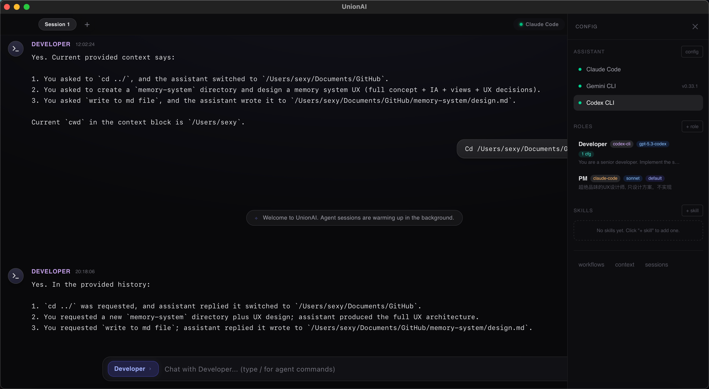

# JockeyUI

A high-performance, open-source Multi-Agent Collaboration Platform built with Tauri, Rust, and SolidJS.



## Features

- **Multi-agent orchestration**: Run Claude Code, Codex CLI, Pi CLI, and Antigravity CLI side by side. ACP (Agent Client Protocol) is the common event and permission surface; each CLI is driven over its most reliable protocol (ACP bridge, native JSON-RPC, or headless stream-json).
- **Projects and sessions**: Group sessions by project, queue input while an agent is busy, cancel a turn without killing the agent process, and resume sessions across app restarts.
- **Transcript import**: Import existing Claude Code, Codex, and Pi sessions into a project.
- **Role-based configuration**: Bind a runtime, model, and mode to each role, and mention roles with `@role`. Each role can have its own MCP servers, skills, and rules.
- **Built-in Jockey MCP**: Agents can read session context, list roles and skills, and invoke other roles.
- **Workspace tools**: Git panel (status, diff, commit, push, PR), terminal, and file tree next to the chat.
- **Web companion**: Reach your sessions from a phone through a lightweight web UI (Settings -> Remote companion; default port 8420, token auth, optional Tailscale for access away from home).
- **Native desktop app**: Tauri 2, Rust, SolidJS, and TailwindCSS v4.

## Demo

Screen recording: [docs/assets/demo.mp4](docs/assets/demo.mp4), also at https://github.com/user-attachments/assets/fd1afbbc-d925-47df-89ed-a1125018f6b4

The walkthrough shows:
1. Asking an assistant for a capability overview.
2. Mentioning a role bound to Claude Code (`@PM Who are you?`) and getting an answer shaped by that role's prompt.
3. Mentioning a role bound to Codex CLI (`@Developer who are you?`), which starts the Codex runtime for that role.
4. Switching models and prompts per role within one chat window.

## Roadmap

- [x] Custom **MCPs and Skills** for each role.
- [ ] Broaden support for **various CLIs** to improve development and tooling workflows.
- [ ] Introduce **Multi-modal Inputs** (e.g., image, voice) for richer interactions.
- [ ] Develop a plugin ecosystem for extended third-party capabilities.

Detailed pending work: [docs/roadmap/pending.md](docs/roadmap/pending.md).

## Tech Stack

- **Frontend**: SolidJS, TypeScript, TailwindCSS v4
- **Backend**: Rust, Tauri v2
- **Protocol**: ACP (Agent Client Protocol)

## Getting Started

### Prerequisites

- [Node.js](https://nodejs.org/) & [pnpm](https://pnpm.io/)
- [Rust toolchain](https://rustup.rs/)

- At least one agent CLI: `claude`, `codex`, `pi`, or `agy`. CLIs are resolved from your interactive shell `PATH`. The Claude ACP bridge installs itself.

### Installation

```bash
# Clone the repository
git clone https://github.com/recailai/jockey.git
cd jockey

# Install dependencies
pnpm install

# Run in development mode (Frontend + Rust Backend hot reload)
pnpm tauri dev
```

### Build

```bash
# Build for production distribution
pnpm tauri build
```

## Project Structure

- `src/`: SolidJS + TypeScript UI.
- `src-tauri/src/`: Rust backend. `lib.rs` registers Tauri commands; `engine/` owns turns, queue, and persistence; `acp/` holds runtime adapters and transports; `db/` is the SQLite layer; `web_gateway/` serves the web companion; `jockey_mcp/` is the built-in MCP bridge; `importer/` imports transcripts; `git/` backs the git panel.
- `docs/`: Architecture notes, reviews, roadmap, and reference material. See [docs/README.md](docs/README.md).

Contributors: see [AGENTS.md](AGENTS.md) for architecture, conventions, and PR guidelines.

## Commands

- `pnpm dev`: Run Vite dev server for frontend iteration. For a named LAN/proxy host, set `JOCKEY_ALLOWED_HOSTS=jockey.example,preview.example` (comma-separated hostnames). IP hosts remain supported; other domains are rejected.
- `pnpm tauri dev`: Run the full desktop app.
- `pnpm build`: Build production frontend assets into `dist/`.
- `pnpm tauri build`: Build distributable desktop bundles.
- `cargo check --manifest-path src-tauri/Cargo.toml`: Fast Rust type check.
- `cargo test --manifest-path src-tauri/Cargo.toml`: Run Rust tests.

## Known Issues

- **Interactive slash commands may hang `claude-code` (ACP bridge) sessions.** Some Claude Code commands (e.g. `/clear`) trigger TUI-level prompts that cannot be answered over the ACP stdio pipe, so the session can freeze. This is an [upstream limitation](https://github.com/anthropics/claude-code/issues/28379). Avoid commands that need confirmation (e.g. `/clear`, `/init`) on roles bound to the `claude-code` runtime.

## License

MIT License
